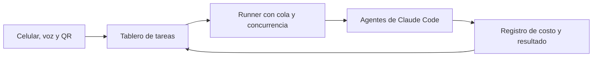

# Manuel Bautista

### AI Automation Engineer en Buenos Aires

Automatizo procesos de punta a punta y construyo agentes de IA que funcionan en producción sin supervisión. El trabajo empieza antes del código, decidiendo qué conviene automatizar, dónde hace falta un modelo y dónde alcanza una regla fija, y termina después, cuando el proceso se controla solo.

## Lo que construí

### Una plataforma de automatización que reemplaza a UiPath

Diseñé desde cero un framework en TypeScript y Playwright sobre el que hoy funcionan 16 procesos, 9 en producción, contra portales del Estado, portales de empleo y sistemas internos de Argentina y Chile. Migré 4 procesos de UiPath a código propio en un mes, uno de ellos sin navegador, y sin licencias.

Cada proceso se despliega y se ejecuta con GitHub Actions sobre runners propios, con costo de infraestructura cero. Un hub central agenda las ejecuciones, junta los errores en un solo lugar y levanta solo las ejecuciones que se cuelgan.

### Un sistema operativo de agentes sobre Claude Code

Por mi cuenta armé una flota de agentes que toma trabajo de un tablero y lo ejecuta sin supervisión.

Un runner en Python lanza un agente por tarea, con concurrencia ajustable en vivo, retoma las tareas cortadas sin ejecutarlas dos veces y registra costo, duración y modelo de cada ejecución. Un watchdog levanta los servicios que se caen y un turno nocturno junta los cambios del día, regenera las vistas con scripts deterministas y propone mejoras. Le hablo desde el celular, con audios que se transcriben en local con Whisper, y las herramientas externas entran por MCP.

### Claudio, una app de voz para manejar agentes

App de escritorio para Windows que muestra las consolas de Claude Code abiertas y en qué está cada una, avisa cuando una termina o necesita una respuesta y deja dictarles con Whisper local. Se instala con un setup y se actualiza sola. [Descargar Claudio](https://github.com/manubautista/Claudio-releases/releases)

### Automatización para pymes

Con mi propio estudio hago automatizaciones e integraciones a medida, desde catálogos con precios que se actualizan solos hasta cartelería que se genera directo desde el ERP del cliente.

## Cómo trabajo

- Si una tarea se repite, la convierto en un proceso que se ejecuta y se controla solo.
- Mido antes de afirmar. Lo que entrego viene con su verificación.
- Uso agentes de IA todos los días para desarrollar, diagnosticar y documentar, y reviso lo que proponen antes de que llegue a producción.
- Documento para que el resto resuelva sin depender de mí.

## Con qué

Python, TypeScript, Playwright, UiPath, Claude Code, MCP, Whisper, SQL Server, MySQL, Node.js, APIs REST, GitHub Actions y PowerShell.

## Por qué hay poco código acá

El código de mi trabajo y de mis clientes es privado. Lo que publique en este perfil van a ser demos con datos inventados.

English

AI Automation Engineer based in Buenos Aires. I automate processes end to end and build AI agents that run in production unattended.

I designed a TypeScript and Playwright automation framework that runs 16 processes, 9 of them in production, and led the migration off UiPath with CI/CD on self-hosted runners at zero infrastructure cost. On my own I built an agent fleet on top of Claude Code, with a Python runner that handles queueing, live concurrency, crash recovery without duplicate runs and cost tracking per run, plus Claudio, a Windows voice app to drive the agents.

My work and client code is private, so what you will find here are demos with made-up data.

[LinkedIn](https://www.linkedin.com/in/manuel-bautista)
